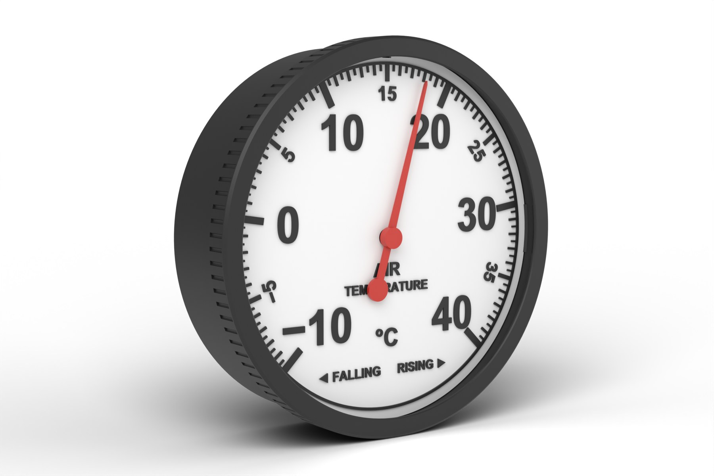

# TemperatureGauge: stepper edition

*Part of the **Open Gauges** project: open, 3D-printable dials for live environmental data.*



A wall-mounted dial that shows the live outside temperature from your weather station. An ESP32-C3 Super Mini reads the temperature from an MQTT feed over Wi-Fi and turns a 28BYJ-48 stepper over a −10 to 40 °C scale. It also works out the 3-hour temperature tendency on the board and lights LEDs beside **RISING** or **FALLING** on the dial.

It shares the case, bezel, pointer, magnet carrier and acrylic window with the [WindGauge stepper edition](../OpenGauges_WindGauge_Stepper/), and the electronics and firmware layout with the [PressureGauge](../OpenGauges_PressureGauge_Stepper/). Only the dial and the firmware settings are different.

- **270° scale:** −10 °C bottom-left, 15 °C at 12 o'clock, 40 °C bottom-right. The pointer never crosses the gap at the bottom.
- **Temperature tendency on board:** a rolling 3-hour history lights RISING (amber) or FALLING (blue). A rapid change (4 °C or more in 3 hours) makes them fade in and out. The history is saved to flash, so a quick reboot doesn't lose it.
- **Self-homing:** the same magnet and KY-003 hall sensor as the wind gauge. The sketch measures the motor's steps per revolution itself and re-zeros every six hours.
- **Backlash compensation:** every move finishes clockwise, so the gearbox play in the 28BYJ-48 doesn't shift the reading.
- **Low power when idle:** the motor coils switch off between moves.

---

## How it works

Your weather station publishes its weeWX loop packet (JSON) to an MQTT broker. The ESP32-C3 subscribes, picks out the outside temperature (`outTemp_C`, `outTemp_F` or a bare `outTemp`), converts °F to °C if needed, smooths it lightly and moves the pointer. Changes under 0.1 °C are ignored, so the pointer doesn't twitch.

## Repository layout

```
print/stl/        temperature dial, oriented for printing (STL)
print/3mf/        the same dial as 3MF
print/flat-dial/  flat two-colour dial (3MF with both parts + separate STLs)
cad/              Fusion 360 archive (.f3d) with all the stepper gauge dials, and STEP files
firmware/         Arduino sketch for the ESP32-C3 Super Mini
images/           render used in this README
```

The case, bezel, pointer, magnet carrier and acrylic window are shared with the wind gauge: print them from [`../OpenGauges_WindGauge_Stepper/print/`](../OpenGauges_WindGauge_Stepper/print/). Their CAD is in [`../OpenGauges_WindGauge_Stepper/cad/`](../OpenGauges_WindGauge_Stepper/cad/).

## Bill of materials

### Printed parts (PLA, 0.2 mm layers, 3 walls, 15 % infill, no supports)

| Part | File | Orientation |
|---|---|---|
| Case | `WG-01_Case_back-down` (WindGauge folder) | Back down |
| Dial, raised (choose one) | `TG-02_Temperature_dial_face-up_M600` | Face up, colour change at 2.2 mm |
| Dial, flat two-colour (choose one) | `TG-02F_Temperature_flat_dial_2colour_Bambu.3mf` | Face down |
| Bezel | `WG-03_Bezel_front-down` (WindGauge folder) | Front down |
| Pointer | `WG-04_Pointer` (WindGauge folder) | Underside down |
| Magnet carrier | `WG-05_Magnet_carrier` (WindGauge folder) | Underside down |

The bezel needs at least 205 mm in one direction: it fits a Prusa MK4 and Bambu X1, P1 and A1, but not an A1 mini or Prusa MINI.

### Printing notes

- **Raised dial:** print in white and add a filament change (M600) at the **2.2 mm** layer so the marks print black.
- **Flat dial:** the black marks are inlaid 0.2 mm (one layer) and the dial prints face down. On a Bambu with AMS, open the 3MF and set *Dial white* / *Marks black*. On a Prusa MK4 without an MMU, use a two-extruder *Single Extruder Multi Material* profile with `M600` as the tool-change G-code and a small wipe tower (see the WindGauge guide).
- The dial's notch sits at 12 o'clock (15 °C) and lines up with the case's N rib, as on the wind gauge.

### Bought parts

| Item | Notes |
|---|---|
| ESP32-C3 Super Mini | Wi-Fi; native USB |
| 28BYJ-48 stepper (5 V) + ULN2003 driver | 5 V version |
| KY-003 hall sensor module (A3144) | |
| Neodymium magnet, Ø5 × up to 3 mm | glued into the carrier |
| WS2812B LED strip, 10 mm wide | 84 LEDs in the sketch; change `NUM_LEDS` to match yours |
| Clear acrylic disc, Ø190 × 3 mm | laser cut from the WindGauge `cad/Acrylic_190mm_x3_disc.dxf` |
| 2 × M3 × 6 pan-head screws | motor ears |
| Jumper wires, USB-C cable, 5 V USB supply | a 2 A supply gives the LEDs headroom |

## Wiring

Identical to the PressureGauge.

| ESP32-C3 Super Mini | Connects to |
|---|---|
| GPIO4 / GPIO3 / GPIO1 / GPIO0 | ULN2003 IN1 / IN2 / IN3 / IN4 |
| GPIO7 | KY-003 S |
| GPIO10 | WS2812B DIN |
| 5V | ULN2003 +, KY-003 +, LED 5V |
| GND | all grounds |

GPIO2, GPIO8 and GPIO9 are strapping pins on the C3, so they're left free.

Everything runs from USB through the Super Mini's 5V pin, wired directly. Optional extras for more margin:

- **Divider on the hall sensor signal:** the KY-003 pulls its output up to 5 V, and the ESP32-C3 is a 3.3 V chip. A 10 kΩ / 20 kΩ divider on the signal keeps GPIO7 within spec. Without it, the module's own 10 kΩ pull-up limits the current, and it works in practice.
- **Power the hall sensor only while homing:** wire KY-003 + to GPIO5 instead of 5V. The sketch switches it on just for homing, which saves a few mA (useful on battery). The A3144 is rated from 4.5 V, so check that yours triggers at 3.3 V; most do.
- **LED strip:** a 330 Ω resistor on LED data and a 1000 µF capacitor across the strip.

## Firmware

[`firmware/TemperatureGauge_ESP32C3/TemperatureGauge_ESP32C3.ino`](firmware/TemperatureGauge_ESP32C3/TemperatureGauge_ESP32C3.ino)

1. Arduino IDE: install **esp32 by Espressif Systems** (v3.x) and select **ESP32C3 Dev Module**.
2. Tools menu: set **USB CDC On Boot** to **Enabled** for the Serial Monitor.
3. Libraries: **AccelStepper**, **PubSubClient**, **ArduinoJson** (v7), **Adafruit NeoPixel**.
4. Edit the settings at the top of the sketch and upload.

| Setting | What it does |
|---|---|
| `ssid`, `password` | your Wi-Fi |
| `mqtt_server`, `mqtt_port`, `temp_topic` | your broker and topic: a weeWX loop packet (JSON) or a plain number in °C (or °F if the topic name ends in `_F`) |
| `bareKeyIsFahrenheit` | units of a bare `outTemp` key with no `_C` / `_F` suffix; weeWX stores US units by default, so this starts as `true` |
| `homeOffsetDeg` | fine-tunes 15 °C at 12 o'clock: pointer short → increase, overshoots → decrease |
| `backlashDeg` | gearbox play to take up on anticlockwise moves (typically 2–6°) |
| `trendOnC`, `trendOffC`, `trendFastC` | 3-hour change that lights RISING / FALLING (1.0 °C), turns them off (0.5 °C), and makes them pulse (4.0 °C) |
| `NUM_LEDS`, `LED_BRIGHTNESS` | LED count and backlight brightness |
| `TREND_BRIGHTNESS`, `TREND_FADE_MIN` | RISING / FALLING brightness, and the low point of the fade |
| `risingLeds`, `fallingLeds` | which LEDs sit beside the words; set `LED_FINDER_MODE` to 1 once to find them |

A normal morning warm-up is typically 2–4 °C over three hours, so RISING will often light during the day. If you only want it to flag unusual changes, raise `trendOnC` to around 2 °C.

### Start-up

The ring shows how far start-up has got, so you can follow it without the Serial Monitor:

| Ring colour | Stage |
|---|---|
| Red | sketch started |
| Blue | connecting to Wi-Fi |
| Yellow | homing and measuring one revolution (motor turning) |
| Purple | self-test sweep: −10 → 40 → 15 °C |
| White | ready |

Wi-Fi connects before the motor runs, so the two biggest power draws never overlap. RISING / FALLING need an hour of readings before they can light.

## Optional: backlight schedule

[`firmware/TemperatureGauge_ESP32C3_Lights/TemperatureGauge_ESP32C3_Lights.ino`](firmware/TemperatureGauge_ESP32C3_Lights/TemperatureGauge_ESP32C3_Lights.ino) is the same sketch with a timer for the backlight. Use it instead of the standard sketch if you don't want the dial lit all night. The wiring and other settings are the same.

| Setting | What it does |
|---|---|
| `lightsMode` | `LIGHTS_ON` (always on), `LIGHTS_OFF` (always off) or `LIGHTS_DUSK` (on at dusk, off at the off time) |
| `lightsOffHour`, `lightsOffMinute` | off time, local; `0`, `0` is midnight, and times after midnight such as `1`, `0` work too |
| `latitude`, `longitude` | where the gauge is, in decimal degrees (west is negative). Dusk is worked out from these each day |
| `duskSunAngle` | what counts as dusk: `-0.833` is sunset, `-6` is civil dusk, about 35 minutes later in the UK |
| `tzInfo` | your time zone, so dusk and the off time are in local time (UK GMT/BST by default) |

RISING and FALLING light in every mode, even with the backlight off. The start-up colours still show in every mode. Until the board has the time from the internet, a second or two after start-up, the backlight stays on. The backlight in this sketch is set to 120.

## Troubleshooting

| Symptom | Fix |
|---|---|
| Ring stays red or dark | Sketch not running: unplug the USB and plug it back in (after an upload the C3 can stay in download mode). |
| Ring stays blue | Wi-Fi not connecting: check the name and password, and that it's a 2.4 GHz network. Transmit power is set low (8.5 dBm) for the Super Mini's small antenna, so try it closer to the router. |
| Ring yellow, motor turning without stopping | Hall sensor not triggering: flip the magnet and keep the gap around 1.5 mm. |
| Ring yellow, motor still | IN1–IN4 wiring or no 5 V on the ULN2003. |
| No Serial Monitor output | USB CDC On Boot must be Enabled; press RST with the monitor open. |
| Reading far too high (e.g. 50 °C+ off the scale) | Your feed is in °F but the key has no suffix: set `bareKeyIsFahrenheit` to `true`. Far too low: set it to `false`. |
| Pointer off by a degree or two after falling temperature | Increase `backlashDeg`. |

## CAD

`cad/WeatherGauges_Stepper.f3d` is the full parametric Fusion 360 model, with the shared case parts and every stepper gauge dial: wind direction, wind speed, barometer, temperature and rainfall. `cad/step/` has the temperature dials as STEP files.

## Licence

- Design files (`print/`, `cad/`, `images/`): [CC BY-NC-SA 4.0](https://creativecommons.org/licenses/by-nc-sa/4.0/)
- Firmware (`firmware/`): [MIT](firmware/LICENSE)

See [`LICENSE.md`](LICENSE.md).

## Credits

Designed and built by **Andy Hudson-Smith**, [digitalurban.org](https://www.digitalurban.org).
