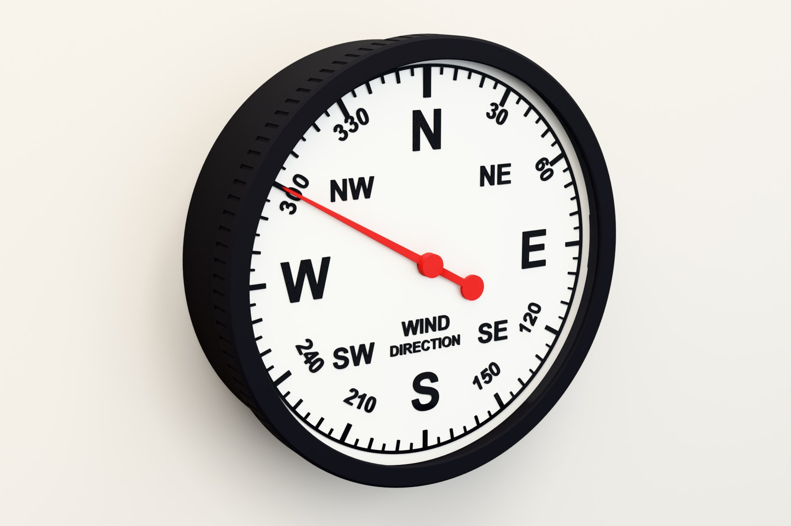
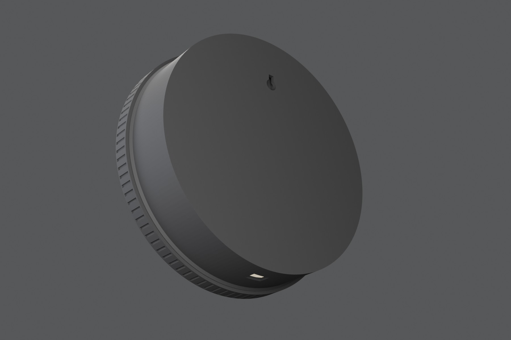

# WindGauge: stepper edition

*Part of the **Open Gauges** project: open, 3D-printable dials for live environmental data.*



A 205 mm wall-mounted dial that shows live wind direction from your weather station. An Arduino Nano 33 IoT reads the bearing from an MQTT feed over Wi-Fi and turns a 28BYJ-48 stepper. A hall sensor finds North on every start-up, and an LED strip lights the dial from behind.

- **Prints on a 220 mm-class bed:** five parts, no supports, largest part 204.8 mm.
- **Self-homing:** a magnet on the pointer carrier passes a KY-003 hall sensor at North. The sketch measures the motor's steps per revolution itself and re-zeros every six hours.
- **Screw-on bezel:** M200 × 4 thread with print clearance, holding a 190 mm × 3 mm acrylic window.
- **Clip-in parts:** dial, LED strip, driver board and breadboard all clip in. One screw hangs it on the wall.
- **Two dial options:** raised marks (single filament change) or a flat two-colour inlay (Bambu AMS or manual swaps on a Prusa MK4).

📘 **Full illustrated build guide:** [`docs/WindGauge_Stepper_HowTo.pdf`](docs/WindGauge_Stepper_HowTo.pdf)

---

## How it works

Your weather station publishes wind direction (degrees) to an MQTT broker. The Nano 33 IoT subscribes and turns the stepper by the shortest path to that bearing. The pointer sits on a printed **magnet carrier** on the motor shaft; a 5 mm magnet in the carrier passes over the hall sensor at North.


| Inside the case (dial removed) | From behind: keyhole and USB opening |
|---|---|
|  |  |

## Repository layout

```
print/stl/        printed parts, oriented for printing (STL)
print/3mf/        the same parts as 3MF
print/flat-dial/  flat two-colour dial (3MF with both parts + separate STLs)
cad/              Fusion 360 archive (.f3d), STEP files, acrylic window DXF
firmware/         Arduino sketch for the Nano 33 IoT
docs/             how-to guide (PDF + editable Word), wiring diagram
images/           renders used in this README
```

## Bill of materials

### Printed parts (PLA, 0.2 mm layers, 3 walls, 15 % infill, no supports)

| Part | File | Orientation |
|---|---|---|
| Case | `WG-01_Case_back-down` | Back down |
| Dial, raised (choose one) | `WG-02_Dial_face-up_M600` | Face up, colour change at 2.2 mm |
| Dial, flat two-colour (choose one) | `WG-02F_Flat_dial_2colour_Bambu.3mf` | Face down |
| Bezel | `WG-03_Bezel_front-down` | Front down |
| Pointer | `WG-04_Pointer` | Underside down |
| Magnet carrier | `WG-05_Magnet_carrier` | Underside down |

The bezel needs at least 205 mm in one direction: it fits a Prusa MK4 and Bambu X1, P1 and A1, but not an A1 mini or Prusa MINI.

### Bought parts

| Item | Notes |
|---|---|
| Arduino Nano 33 IoT (with headers) | Wi-Fi via WiFiNINA |
| Mini breadboard, 170 tie-points | ~46 × 35 × 9.4 mm; side tabs clip into the tray notches |
| 28BYJ-48 stepper (5 V) + ULN2003 driver | 5 V version |
| KY-003 hall sensor module (A3144) | |
| Neodymium magnet, Ø5 × up to 3 mm | glued into the carrier |
| WS2812B LED strip, 10 mm wide, ≤ 2.2 mm thick | ~0.6 m; bare or IP30 (not silicone-sleeved) |
| Clear acrylic disc, Ø190 × 3 mm | laser cut from `cad/Acrylic_190mm_x3_disc.dxf` |
| 2 × M3 × 6 pan-head screws | motor ears |
| Jumper wires, micro-USB cable, 5 V USB supply | a 2 A supply gives the LEDs headroom |
| 1 × wall screw | head ≤ 9.5 mm across, ≤ 3.5 mm thick |

## Printing notes

- **Raised dial:** print in white and add a filament change (M600) at the **2.2 mm** layer so the marks print black.
- **Flat dial:** the black marks are inlaid 0.6 mm and the dial prints face down. On a Bambu with AMS, open the 3MF and set *Dial white* / *Marks black*. On a Prusa MK4 without an MMU, use a two-extruder *Single Extruder Multi Material* profile with `M600` as the tool-change G-code and a small wipe tower (see the guide).
- The pointer and magnet carrier push on until they stop. Those stops keep the pointer 1 mm above the dial and 1 mm below the acrylic.


## Assembly (short version)

1. Test-fit the dial and bezel before adding electronics.
2. Drop the 28BYJ-48 into its pocket (wire cover down) and fix it with 2 × M3 × 6.
3. Snap the ULN2003 into its cradle and plug in the motor.
4. Press the breadboard into the bottom tray (tabs into the notches), Nano USB end towards the wall.
5. Lay the A3144 flat on its shelf and snap the KY-003 in.
6. Check the magnet's polarity (KY-003 LED lights), glue it into the carrier, and push the carrier onto the shaft.
7. Clip the LED strip into the channel, starting at the wire gap at 5 o'clock.
8. Wire up, upload the sketch and watch it home.
9. Clip the dial in (notch to the N rib), then push on the pointer.
10. Clip the acrylic into the bezel and screw it on.
11. Hang it: the keyhole puts the screw 67 mm above the dial centre.

## Wiring


| Nano 33 IoT | Connects to |
|---|---|
| D9 / D10 / D11 / D12 | ULN2003 IN1 / IN2 / IN3 / IN4 |
| D8 | KY-003 S |
| D7 | WS2812B DIN |
| +5V | ULN2003 +, KY-003 +, LED 5V |
| GND | all grounds |

Everything runs from USB through the Nano's +5V pin, wired directly. Optional extras for more margin: a 10 kΩ / 20 kΩ divider on the KY-003 signal (its output is pulled up to 5 V and the Nano is a 3.3 V board), and a 330 Ω resistor on LED data plus a 1000 µF capacitor across the strip.

## Firmware

[`firmware/WindGauge_Nano33IoT/WindGauge_Nano33IoT.ino`](firmware/WindGauge_Nano33IoT/WindGauge_Nano33IoT.ino)

1. Arduino IDE: install **Arduino SAMD Boards** and select **Arduino Nano 33 IoT**.
2. Libraries: **AccelStepper**, **WiFiNINA**, **PubSubClient**, **Adafruit NeoPixel**.
3. Edit the settings at the top of the sketch and upload.

| Setting | What it does |
|---|---|
| `ssid`, `password` | your Wi-Fi |
| `mqtt_server`, `mqtt_port`, `wind_topic` | your broker and topic; the payload is plain degrees, e.g. `247` |
| `neoNumPixels`, `neoBrightness` | LED count and brightness (lower it if the board resets) |
| `northOffsetDeg` | fine-tunes North: pointer short of N → increase, overshoots → decrease |

On start-up the gauge homes on the magnet, measures one full revolution, moves to true North, sweeps to South and back as a self-test, then connects to Wi-Fi and MQTT.

## Troubleshooting

| Symptom | Fix |
|---|---|
| Motor keeps turning at start-up | Hall sensor not triggering: flip the magnet; the gap should be ~1.5 mm. |
| ULN2003 LEDs and strip dark | No 5 V on the +5V pin. Some older Nano 33 IoT boards need the VUSB pads bridged. |
| Motor buzzes, doesn't turn | IN1–IN4 out of order (D9–D12 in order). |
| Board resets when LEDs light | Lower `neoBrightness` or use a stronger supply. |
| Pointer rubs | Push the carrier and pointer fully home; both have hard stops. |

## CAD

`cad/` has the full parametric Fusion 360 model (`.f3d`) and STEP files. The breadboard tray, notch width, clearances and dial geometry are user parameters, so you can adapt them to your parts.

## Licence

- Design files (`print/`, `cad/`, `docs/`, `images/`): [CC BY-NC-SA 4.0](https://creativecommons.org/licenses/by-nc-sa/4.0/)
- Firmware (`firmware/`): [MIT](firmware/LICENSE)

See [`LICENSE.md`](LICENSE.md).

## Credits

Designed and built by **Andy Hudson-Smith**, [digitalurban.org](https://www.digitalurban.org).
