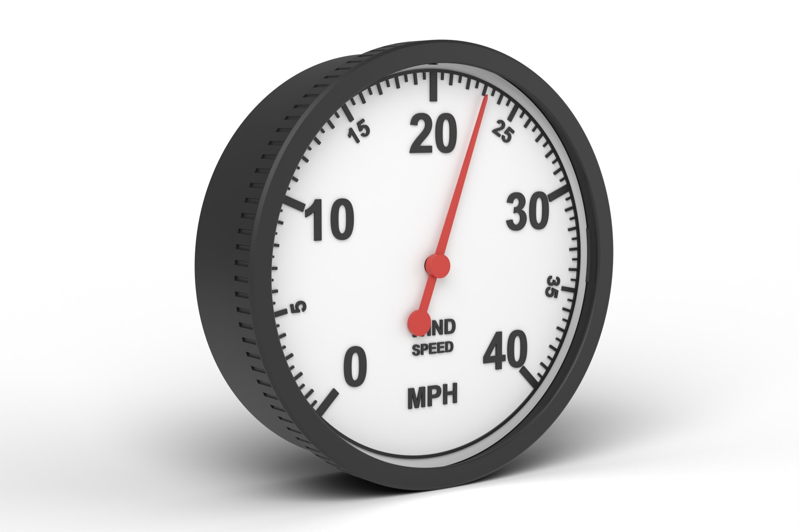

# WindSpeedGauge: stepper edition

*Part of the **Open Gauges** project: open, 3D-printable dials for live environmental data.*



A wall-mounted dial that shows live wind gusts from your weather station. An ESP32-C3 Super Mini reads the 1-minute gust speed from an MQTT feed over Wi-Fi and turns a 28BYJ-48 stepper over a 0–40 mph scale. It also keeps track of the day's highest gust and lights a red LED beside it on the dial.

It shares the case, bezel, pointer, magnet carrier and acrylic window with the [WindGauge stepper edition](../OpenGauges_WindGauge_Stepper/), and the board, wiring and firmware layout with the wind direction, [PressureGauge](../OpenGauges_PressureGauge_Stepper/) and [TemperatureGauge](../OpenGauges_TemperatureGauge_Stepper/). Only the dial and the firmware settings are different.

- **270° scale:** 0 mph bottom-left, 20 mph at 12 o'clock, 40 mph bottom-right. The pointer never crosses the gap at the bottom.
- **Every gust shown:** no averaging. The pointer moves to each new reading as it arrives.
- **Day's maximum:** the ESP32 tracks the highest gust since midnight and lights the LED beside it in red. It resets at local midnight and is saved to flash, so a reboot or power cut doesn't lose it.
- **Self-homing:** the same magnet and KY-003 hall sensor as the wind gauge. The sketch measures the motor's steps per revolution itself and re-zeros every six hours.
- **Backlash compensation:** every move finishes clockwise, so the gearbox play in the 28BYJ-48 doesn't shift the reading.
- **Low power when idle:** the motor coils switch off between moves.

---

## How it works

Your weather station publishes the 1-minute wind gust (mph) to an MQTT broker. The ESP32-C3 subscribes and moves the pointer straight to each reading; changes under 0.2 mph are ignored so the pointer doesn't twitch. A plain number in mph works, as does km/h, m/s or knots (by topic suffix), or a JSON packet with a gust key.

## Repository layout

```
print/stl/        wind speed dial, oriented for printing (STL)
print/3mf/        the same dial as 3MF
print/flat-dial/  flat two-colour dial (3MF with both parts + separate STLs)
cad/              Fusion 360 archive (.f3d) with all the stepper gauge dials, and STEP files
firmware/         Arduino sketch for the ESP32-C3 Super Mini
images/           render used in this README
```

The case, bezel, pointer, magnet carrier and acrylic window are shared with the wind gauge: print them from [`../OpenGauges_WindGauge_Stepper/print/`](../OpenGauges_WindGauge_Stepper/print/). Their CAD is in [`../OpenGauges_WindGauge_Stepper/cad/`](../OpenGauges_WindGauge_Stepper/cad/).

## Bill of materials

### Printed parts (PLA, 0.2 mm layers, 3 walls, 15 % infill, no supports)

| Part | File | Orientation |
|---|---|---|
| Case | `WG-01_Case_back-down` (WindGauge folder) | Back down |
| Dial, raised (choose one) | `SG-02_WindSpeed_dial_face-up_M600` | Face up, colour change at 2.2 mm |
| Dial, flat two-colour (choose one) | `SG-02F_WindSpeed_flat_dial_2colour_Bambu.3mf` | Face down |
| Bezel | `WG-03_Bezel_front-down` (WindGauge folder) | Front down |
| Pointer | `WG-04_Pointer` (WindGauge folder) | Underside down |
| Magnet carrier | `WG-05_Magnet_carrier` (WindGauge folder) | Underside down |

The bezel needs at least 205 mm in one direction: it fits a Prusa MK4 and Bambu X1, P1 and A1, but not an A1 mini or Prusa MINI.

### Printing notes

- **Raised dial:** print in white and add a filament change (M600) at the **2.2 mm** layer so the marks print black.
- **Flat dial:** the black marks are inlaid 0.2 mm (one layer) and the dial prints face down. On a Bambu with AMS, open the 3MF and set *Dial white* / *Marks black*. On a Prusa MK4 without an MMU, use a two-extruder *Single Extruder Multi Material* profile with `M600` as the tool-change G-code and a small wipe tower (see the WindGauge guide).
- The dial's notch sits at 12 o'clock (20 mph) and lines up with the case's N rib, as on the wind gauge.

### Bought parts

| Item | Notes |
|---|---|
| ESP32-C3 Super Mini | Wi-Fi; native USB |
| 28BYJ-48 stepper (5 V) + ULN2003 driver | 5 V version |
| KY-003 hall sensor module (A3144) | |
| Neodymium magnet, Ø5 × up to 3 mm | glued into the carrier |
| WS2812B LED strip, 144 LEDs/m, 10 mm wide | 84 LEDs in the sketch; change `NUM_LEDS` to match yours |
| Clear acrylic disc, Ø190 × 3 mm | laser cut from the WindGauge `cad/Acrylic_190mm_x3_disc.dxf` |
| 2 × M3 × 6 pan-head screws | motor ears |
| Jumper wires, USB-C cable, 5 V USB supply | a 2 A supply gives the LEDs headroom |

## Wiring

Identical to the wind direction, pressure and temperature gauges: see the [wiring diagram](../OpenGauges_WindGauge_Stepper/docs/Wiring_ESP32C3.png).

| ESP32-C3 Super Mini | Connects to |
|---|---|
| GPIO4 / GPIO3 / GPIO1 / GPIO0 | ULN2003 IN1 / IN2 / IN3 / IN4 |
| GPIO7 | KY-003 S |
| GPIO10 | WS2812B DIN |
| 5V | ULN2003 +, KY-003 +, LED 5V |
| GND | all grounds |

GPIO2, GPIO8 and GPIO9 are strapping pins on the C3, so they're left free.

Everything runs from USB through the Super Mini's 5V pin, wired directly. Optional extras for more margin:

- **Divider on the hall sensor signal:** the KY-003 pulls its output up to 5 V, and the ESP32-C3 is a 3.3 V chip. A 10 kΩ / 20 kΩ divider on the signal keeps GPIO7 within spec. Without it, the module's own 10 kΩ pull-up limits the current, and it works in practice.
- **Power the hall sensor only while homing:** wire KY-003 + to GPIO5 instead of 5V. The sketch switches it on just for homing, which saves a few mA (useful on battery). The A3144 is rated from 4.5 V, so check that yours triggers at 3.3 V; most do.
- **LED strip:** a 330 Ω resistor on LED data and a 1000 µF capacitor across the strip.

## Firmware

[`firmware/WindSpeedGauge_ESP32C3/WindSpeedGauge_ESP32C3.ino`](firmware/WindSpeedGauge_ESP32C3/WindSpeedGauge_ESP32C3.ino)

1. Arduino IDE: install **esp32 by Espressif Systems** (v3.x) and select **ESP32C3 Dev Module**.
2. Tools menu: set **USB CDC On Boot** to **Enabled** for the Serial Monitor.
3. Libraries: **AccelStepper**, **PubSubClient**, **ArduinoJson** (v7), **Adafruit NeoPixel**.
4. Edit the settings at the top of the sketch and upload.

| Setting | What it does |
|---|---|
| `ssid`, `password` | your Wi-Fi |
| `mqtt_server`, `mqtt_port`, `speed_topic` | your broker and topic: a plain number in mph (or km/h, m/s, knots if the topic ends in `_kph`, `_mps`, `_knot`), or JSON with a gust key |
| `tzInfo` | your time zone, for resetting the day's maximum at midnight (UK GMT/BST by default) |
| `homeOffsetDeg` | fine-tunes 20 mph at 12 o'clock: pointer short → increase, overshoots → decrease |
| `backlashDeg` | gearbox play to take up on anticlockwise moves (typically 2–6°) |
| `moveDeadbandMph` | ignore changes smaller than this (0.2 mph) |
| `NUM_LEDS`, `LED_BRIGHTNESS` | LED count and backlight brightness |
| `MAX_BRIGHTNESS`, `maxRGB` | brightness and colour of the day's-maximum LED (red) |
| `led0BearingDeg`, `ledsPerMetre`, `stripRadiusMm`, `ledDirection` | where the strip sits, so the right LED lights beside the maximum (see below) |

### Lining up the maximum LED

LED 0 sits at the gap just right of the bottom of the dial (`led0BearingDeg` = 148°, measured on the built gauge), and the strip runs anticlockwise from there. With a 144 LEDs/m strip round the case's LED channel (about 95 mm radius) that's roughly 86 LEDs per turn, 4.2° apart, so 0 mph is LED 68, 20 mph LED 35 and 40 mph LED 3.

During the start-up self-test the red LED follows the pointer to 0, 40 and 20 mph. If it sits beside the pointer each time, you're set. If it's ahead of the pointer (clockwise), lower `led0BearingDeg`; if it's behind, raise it. For a 60 LEDs/m strip, change `ledsPerMetre`.

### Start-up

The ring shows how far start-up has got, so you can follow it without the Serial Monitor:

| Ring colour | Stage |
|---|---|
| Red | sketch started |
| Blue | connecting to Wi-Fi |
| Yellow | homing and measuring one revolution (motor turning) |
| Purple | self-test sweep: 0 → 40 → 20 mph, with the red LED following the pointer |
| White | ready (plus today's maximum in red) |

Wi-Fi connects before the motor runs, so the two biggest power draws never overlap.

## Troubleshooting

| Symptom | Fix |
|---|---|
| Ring stays red or dark | Sketch not running: unplug the USB and plug it back in (after an upload the C3 can stay in download mode). |
| Ring stays blue | Wi-Fi not connecting: check the name and password, and that it's a 2.4 GHz network. Transmit power is set low (8.5 dBm) for the Super Mini's small antenna, so try it closer to the router. |
| Ring yellow, motor turning without stopping | Hall sensor not triggering: flip the magnet and keep the gap around 1.5 mm. |
| Ring yellow, motor still | IN1–IN4 wiring or no 5 V on the ULN2003. |
| No Serial Monitor output | USB CDC On Boot must be Enabled; press RST with the monitor open. |
| Maximum LED off to one side of the pointer | Adjust `led0BearingDeg` (see above). |
| Maximum never resets | The clock isn't set: check the board can reach `pool.ntp.org`. |
| Pointer off by a degree or two after falling wind | Increase `backlashDeg`. |

## CAD

`cad/WeatherGauges_Stepper.f3d` is the full parametric Fusion 360 model, with the shared case parts and every stepper gauge dial: wind direction, wind speed, barometer, temperature and rainfall. `cad/step/` has the wind speed dials as STEP files.

## Licence

- Design files (`print/`, `cad/`, `images/`): [CC BY-NC-SA 4.0](https://creativecommons.org/licenses/by-nc-sa/4.0/)
- Firmware (`firmware/`): [MIT](firmware/LICENSE)

See [`LICENSE.md`](LICENSE.md).

## Credits

Designed and built by **Andy Hudson-Smith**, [digitalurban.org](https://www.digitalurban.org).
