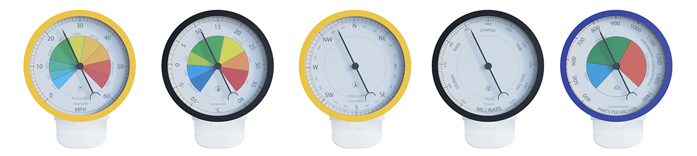
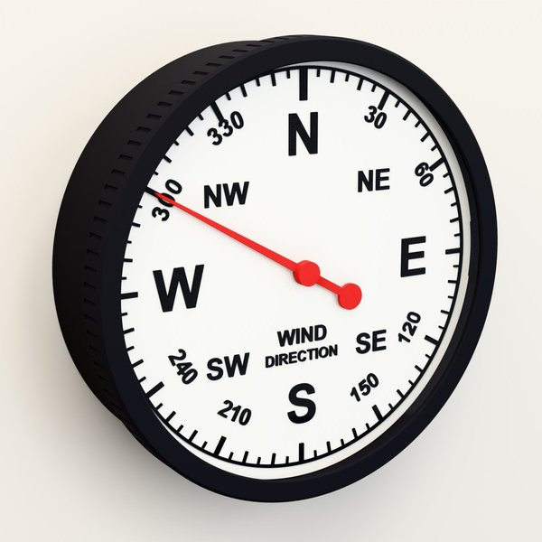
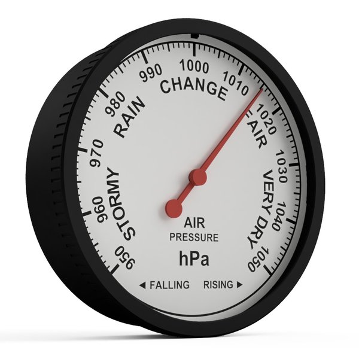
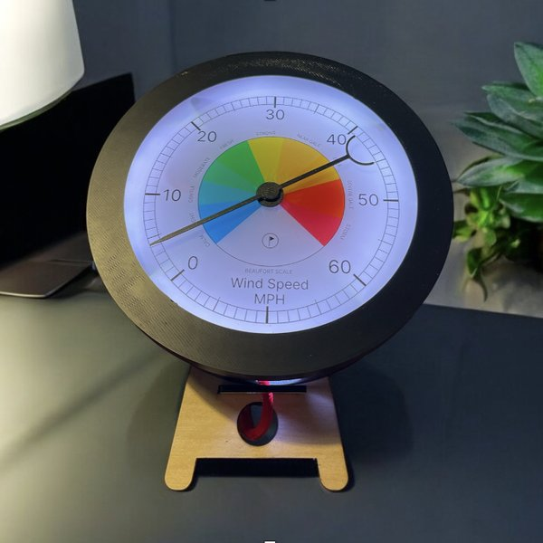
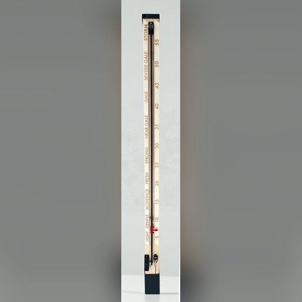
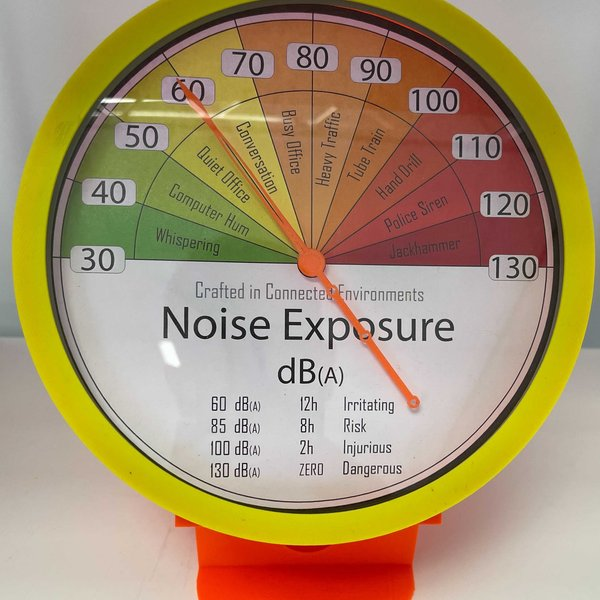
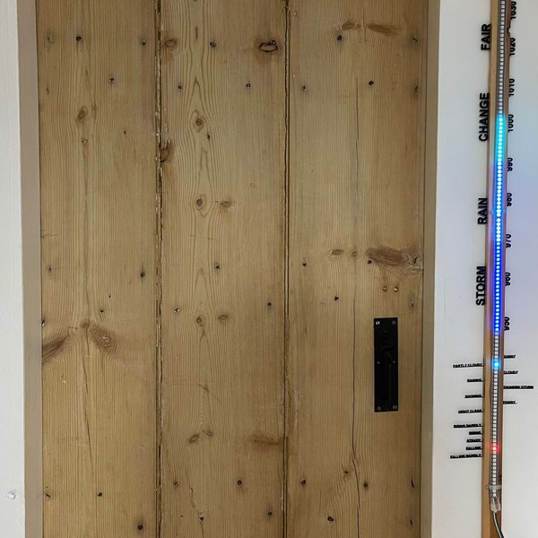
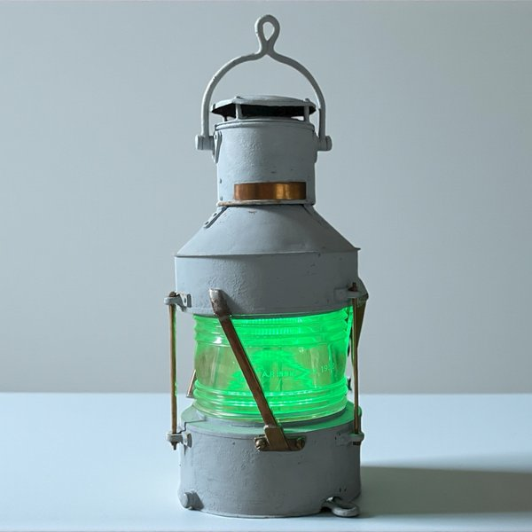
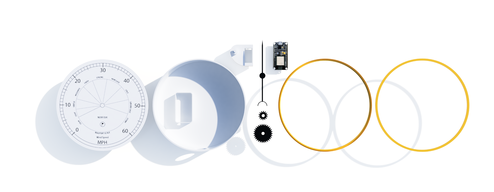
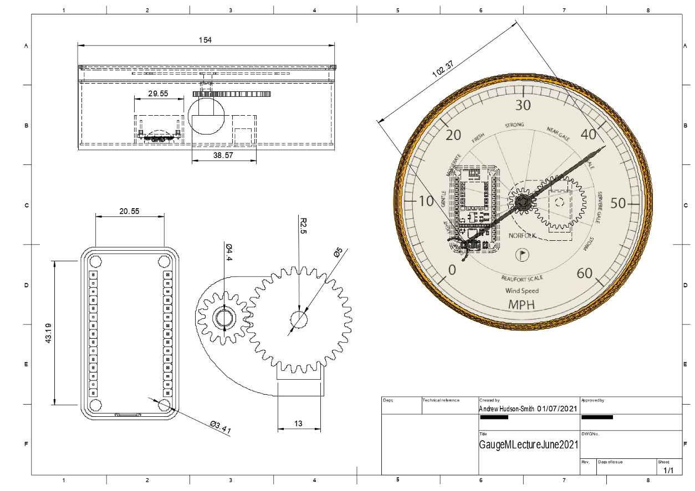

# Open Gauges

**Open-source, 3D-printable data gauges for live environmental data.** This repository holds the Arduino and MicroPython code, 3D print files, CAD and dial graphics for the Open Gauges project.

Open Gauges comes from the [Connected Environments Lab](https://connected-environments.org/) at [The Centre for Advanced Spatial Analysis](https://www.ucl.ac.uk/bartlett/casa), [University College London](https://www.ucl.ac.uk). It began as part of the Sensor Data Visualisation module on the MSc in Connected Environments.

The aim is open-source data gauges that anyone can build, modify and view, both as physical 3D-printed objects and as digital gauges. A gauge can run from any online data feed: weather data such as air pressure, temperature and wind speed, through to air quality, noise and energy. Most of the gauges here read their data over Wi-Fi from an MQTT broker.

The project was created by [Professor Andrew Hudson-Smith](https://connected-environments.org/people/) and [Dr Valerio Signorelli](https://connected-environments.org/people/).

---

## The gauges

<table>
<tr>
<td width="33%" valign="top" align="center"> <b><a href="Contributed/OpenGauges_WindGauge_Stepper/">Wind Direction Gauge</a></b> Stepper-driven wall dial with hall-sensor homing and an LED-lit face. Full build guide.</td>
<td width="33%" valign="top" align="center"> <b><a href="Contributed/OpenGauges_PressureGauge_Stepper/">Air Pressure Gauge</a></b> The same case with a barometer dial, ESP32-C3, and RISING / FALLING trend lights.</td>
<td width="33%" valign="top" align="center"> <b><a href="Contributed/StepperGauge/">Dial Stepper Gauge</a></b> A stepper motor dial for any data range, with a limit switch for homing.</td>
</tr>
<tr>
<td width="33%" valign="top" align="center"> <b><a href="Contributed/Linear%20Stepper%20Gauge/">Linear Stepper Gauge</a></b> A belt-driven pointer that moves along a straight scale.</td>
<td width="33%" valign="top" align="center"> <b><a href="Contributed/NoiseGauge/">Noise Gauge</a></b> Shows noise exposure levels on a printed dial.</td>
<td width="33%" valign="top" align="center"> <b><a href="Contributed/NeoPixelBarometer/">NeoPixel Barometer</a></b> A light tube barometer. Also in <a href="Contributed/OpenWeatherMapNeoPixelBarometer/">Open Weather Map</a> and <a href="Contributed/WindSpeedNeoPixelGauge/">wind speed</a> versions. <a href="https://connected-environments.org/open-gauges/neopixel-barometer/">Blog post</a>.</td>
</tr>
<tr>
<td width="33%" valign="top" align="center"> <b><a href="Contributed/Lightsaber_DataTube/">Lightsaber Data Tube</a></b> A NeoPixel-filled tube that shows live wind speed.</td>
<td width="33%" valign="top" align="center"> <b><a href="Contributed/ShipsLamp/Readme.md">Ships Lamp Gauge</a></b> A ship's lamp that glows with the wind speed.</td>
<td width="33%" valign="top" align="center"><b><a href="Contributed/Voltmeter%20Gauge/">Voltmeter Gauge</a></b> A panel voltmeter driven by PWM from an Arduino, with a printed dial face. <a href="https://connected-environments.org/making/open-gauges-the-voltmeter-gauge/">Blog post</a>.  <b><a href="Contributed/MarbleWindDirectoinGauge/">Marble Wind Direction Gauge</a></b> Print files for a marble that rolls to the wind direction.</td>
</tr>
</table>

---

## The original servo gauge

The first Open Gauges design is a 150 mm dial driven by a servo, with an LED-lit face. It was released with five dial graphics, each sized to fit the 3D-printed case:

| Dial | Range |
|---|---|
| Temperature | −10 to 40 °C |
| Wind speed | 0–60 mph |
| Wind direction | 0–360° |
| Air pressure | 950–1050 mb |
| CO₂ | 400–1400 ppm |

### How it works

The code reads data from an MQTT feed and drives an SG90 servo using the ServoEasing library. A gear train extends the servo's range, so any gauge from 180° to 360° can be built, and the range is calibrated in code. On start-up the servo sweeps the full scale to help with calibration. A time function turns the LEDs and servo off at night and back on in the morning.

*Two gauges set to a 270° range: wind speed on one, air quality from a Davis Air Quality unit on the other.*

### Build it

- **Parts:** see [Parts List](Parts%20List.md). In short: a NodeMCU board, an SG90 or MG90S servo, small LED backlights, PLA, and a paper dial laid on a disc printed in transparent PLA.
- **Print:** [`3D Print Files/`](3D%20Print%20Files/), or laser-cut the case from [`Laser Cut Files/`](Laser%20Cut%20Files/).
- **Code:** [`Arduino/`](Arduino/) for Arduino boards or [`Micropython/`](Micropython/) for the Raspberry Pi Pico W. Set-up and calibration details are in the comments at the top of each sketch.
- **Dials:** print a dial from [`Graphics Files/`](Graphics%20Files/), or design your own.

The gauges are kept as simple as possible to make, while staying flexible enough to show a wide range of data.

---

## Repository layout

| Folder | Contents |
|---|---|
| [`Contributed/`](Contributed/) | the newer gauges, each with its own README (see [The gauges](#the-gauges)) |
| [`Arduino/`](Arduino/) | Arduino sketches for the servo and stepper gauges |
| [`Micropython/`](Micropython/) | MicroPython code for Raspberry Pi Pico W gauges and light tubes |
| [`3D Print Files/`](3D%20Print%20Files/) | STL files for the original servo gauge (2022 and 2023 editions) |
| [`Fusion360/`](Fusion360/) | Fusion 360 archives of the original gauge |
| [`Laser Cut Files/`](Laser%20Cut%20Files/) | laser-cut case and stand |
| [`Graphics Files/`](Graphics%20Files/) | dial graphics, ready to print |
| [`Blender/`](Blender/), [`FBX/`](FBX/) | 3D models and animations for digital and AR versions |
| [`imgs/`](imgs/) | images used in this README |

---

## Contributing

New gauges are welcome, whether new code, new dials or a whole new design. Copy [`Contributed/Template/`](Contributed/Template/) into a new folder under `Contributed/`, add your files and a README, and open a pull request. Notable additions are featured on this page.

## Licence

The repository is released under the [MIT licence](LICENSE). Some contributed gauges license their design files separately (for example CC BY-NC-SA 4.0), so check the README in each gauge's folder.
